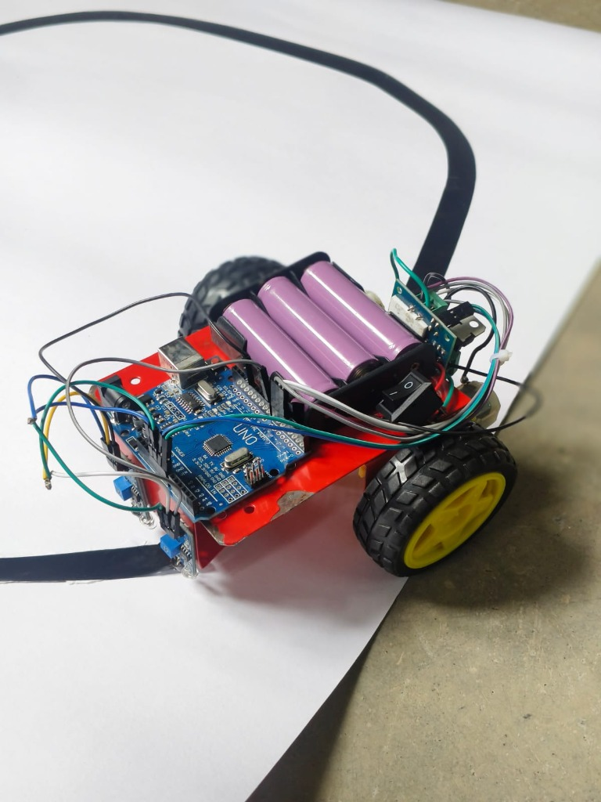
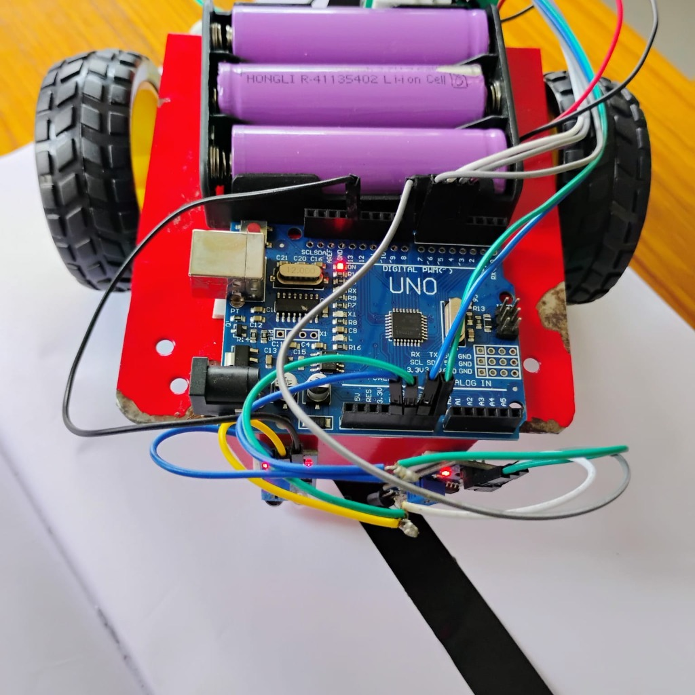
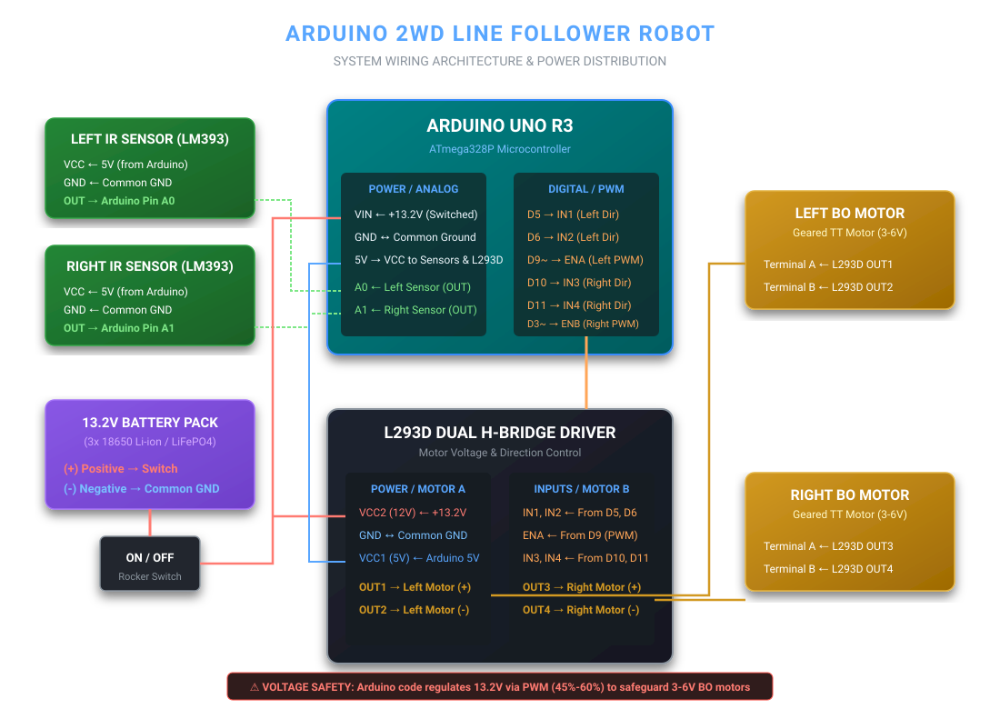

<div align="center">

# 🤖 Arduino 2WD Autonomous Line Follower Robot

An open-source, robust differential-drive autonomous line tracking robot powered by an **Arduino Uno**, **Dual H-Bridge L293D**, **2x Infrared (IR) Reflectance Sensors**, and a high-discharge **13.2V Battery Pack** with software-level PWM voltage regulation.

[](.github/workflows/arduino-ci.yml)
[](https://www.arduino.cc/)
[](LineFollower/LineFollower.ino)
[](LICENSE)
[](docs/PINOUT.md)

<br/>

<table align="center">
  <tr>
    <td align="center">
      
      <br/>
      <em>Figure 1: Robot tracking curved path on paper track</em>
    </td>
    <td align="center">
      
      <br/>
      <em>Figure 2: Top-down view showing Arduino, 3-cell battery holder & switch</em>
    </td>
  </tr>
</table>

</div>

---

## 📋 Table of Contents
1. [Overview & Key Features](#-overview--key-features)
2. [Bill of Materials (BOM)](#-bill-of-materials-bom)
3. [⚡ Voltage Management (13.2V Battery & BO Motors)](#-voltage-management-132v-battery--bo-motors)
4. [System Architecture & Schematic](#-system-architecture--schematic)
5. [Pinout & Wiring Matrix](#-pinout--wiring-matrix)
6. [Decision Logic & State Truth Table](#-decision-logic--state-truth-table)
7. [Getting Started & Uploading Firmware](#-getting-started--uploading-firmware)
8. [Sensor Calibration & Tuning](#-sensor-calibration--tuning)
9. [Serial Telemetry & Diagnostics](#-serial-telemetry--diagnostics)
10. [Repository Structure](#-repository-structure)
11. [Troubleshooting](#-troubleshooting)
12. [License & Contributing](#-license--contributing)

---

## 🌟 Overview & Key Features

This project implements an autonomous 2-wheel-drive line-tracking robotic vehicle. Using two differential infrared reflectance sensors positioned ahead of the front axle, the robot monitors high/low contrast boundaries (such as black electrical tape on a white background) and dynamically computes corrective steering vectors.

### Highlight Features:
* **PWM Safe-Voltage Limiting**: Compensates for high-voltage battery packs (13.2V) by capping PWM duty cycle to safely drive standard 3V–6V yellow BO toy motors without burnout.
* **Dual L293D Control Modes**: Native support for both **6-pin configuration** (with hardware ENA/ENB PWM speed channels) and **4-pin configuration** (jumpered enable pins with direct IN-channel PWM).
* **State Machine Decision Matrix**: Instantaneous sub-millisecond reaction loop for straight line cruising, slight course correction, and zero-radius pivot spins.
* **Live Telemetry & Diagnostics**: Real-time sensor states and action streaming via Serial Monitor (`9600 baud`) with a startup self-test routine.
* **Modular Codebase**: Pin mappings, sensor polarity, and speed thresholds isolated into easy-to-configure constants.

---

## 📦 Bill of Materials (BOM)

| Component | Quantity | Specification / Description |
| :--- | :---: | :--- |
| **Arduino Uno R3** | 1 | ATmega328P microcontroller board (DIP or SMD clone) |
| **Dual H-Bridge Driver** | 1 | L293D Motor Driver Module / Shield (supports up to 36V, 600mA/ch) |
| **Geared BO Toy Motors** | 2 | TT Gearbox DC Motors (Dual shaft, 1:48 reduction ratio, 3V–6V rated) |
| **Wheels & Caster** | 2 + 1 | 65mm rubber-tread wheels + 1x front omnidirectional ball caster |
| **IR Line Tracking Modules** | 2 | LM393 comparator-based infrared reflectance sensor boards |
| **Battery Pack** | 1 | 13.2V pack (3x 18650 Li-ion cells in series / LiFePO4 pack) |
| **SPST Rocker Switch** | 1 | 2-pin master power disconnect switch |
| **Robot Chassis Plate** | 1 | 2WD acrylic / metal mounting chassis plate |
| **Jumper Wires & Hardware** | - | Male-to-Female & Male-to-Male DuPont wires, M3 standoffs & screws |

---

## ⚡ Voltage Management (13.2V Battery & BO Motors)

> [!WARNING]
> **BO Toy Motors are rated for 3V to 6V DC (absolute maximum ~9V).**
> Connecting a 13.2V battery pack directly at 100% duty cycle will lead to excessive RPM, violent line overshoot, stripped internal plastic gears, and motor coil failure.

### Voltage Compensation via PWM:
The L293D dual H-bridge introduces an internal bipolar Darlington transistor drop of approximately **$1.4\text{V} - 1.8\text{V}$**. 

The effective root-mean-square (RMS) voltage seen across the motor terminals is governed by the PWM duty cycle:

$$V_{\text{motor\_effective}} \approx (V_{\text{battery}} - V_{\text{L293D\_drop}}) \times \left( \frac{\text{PWM\_Value}}{255} \right)$$

For this robot:
* **Battery Voltage ($V_{\text{battery}}$)**: $13.2\text{V}$
* **Internal Driver Drop ($V_{\text{drop}}$)**: $\approx 1.8\text{V}$
* **Net Available Voltage**: $13.2\text{V} - 1.8\text{V} = 11.4\text{V}$
* **Configured Cruise Duty Cycle (`BASE_SPEED = 130`)**: $\frac{130}{255} \approx 51\%$
* **Resulting Motor Voltage**: $11.4\text{V} \times 0.51 \approx \mathbf{5.8\text{V}}$ *(Safely within the 3V–6V spec!)*

---

## 📐 System Architecture & Schematic

Below is the complete wiring and power distribution architecture:

<div align="center">
  
</div>

---

## 🔌 Pinout & Wiring Matrix

### 1. Arduino Uno to L293D Motor Driver
| Arduino Pin | L293D Pin | Function | Notes |
| :--- | :--- | :--- | :--- |
| **D5** | **IN1** | Left Motor Direction 1 | High/Low logic |
| **D6** | **IN2** | Left Motor Direction 2 | High/Low logic |
| **D9** (PWM) | **ENA** | Left Motor Speed | PWM duty cycle control (remove jumper) |
| **D10** | **IN3** | Right Motor Direction 1 | High/Low logic |
| **D11** | **IN4** | Right Motor Direction 2 | High/Low logic |
| **D3** (PWM) | **ENB** | Right Motor Speed | PWM duty cycle control (remove jumper) |
| **5V** | **VCC1** | Logic Supply (5V) | Powered from Arduino 5V pin |
| **GND** | **GND** | Ground Reference | Common ground with battery and Arduino |

### 2. Arduino Uno to IR Line Sensors (LM393)
| Sensor Module | Module Pin | Arduino Pin | Notes |
| :--- | :--- | :--- | :--- |
| **Left Sensor** | **VCC** | **5V** | Shared 5V power bus |
| **Left Sensor** | **GND** | **GND** | Shared common ground |
| **Left Sensor** | **OUT** | **A0** | Configured as digital input (`INPUT`) |
| **Right Sensor** | **VCC** | **5V** | Shared 5V power bus |
| **Right Sensor** | **GND** | **GND** | Shared common ground |
| **Right Sensor** | **OUT** | **A1** | Configured as digital input (`INPUT`) |

### 3. Power Distribution
| Source | Switch / Terminal | Target | Function |
| :--- | :--- | :--- | :--- |
| **Battery (+) 13.2V** | SPST Rocker Switch | **Arduino VIN** | Arduino onboard linear regulator |
| **Battery (+) 13.2V** | SPST Rocker Switch | **L293D VCC2 / 12V** | Motor driver H-bridge supply |
| **Battery (-) GND** | Direct Rail | **L293D GND & Arduino GND** | Master Common Ground |
| **L293D OUT1, OUT2** | Screw Terminals | **Left BO Motor** | Left drive wheel |
| **L293D OUT3, OUT4** | Screw Terminals | **Right BO Motor** | Right drive wheel |

For detailed connection notes and diagrams, see [`docs/PINOUT.md`](docs/PINOUT.md).

---

## 🧠 Decision Logic & State Truth Table

The robot uses a differential reflectance tracking algorithm where the two sensors straddle the black line:

```
          [Left Sensor]        [Right Sensor]
               |                    |
               v                    v
         [  WHITE  ]  |BLACK LINE|  [  WHITE  ]    ===>  ACTION: MOVE FORWARD
```

### Truth Table:
| Left Sensor | Right Sensor | Track Condition | Motion State | Left Wheel | Right Wheel |
| :---: | :---: | :--- | :--- | :---: | :---: |
| **WHITE (0)** | **WHITE (0)** | Centered on track | **Drive Forward** | `BASE_SPEED` (Fwd) | `BASE_SPEED` (Fwd) |
| **BLACK (1)** | **WHITE (0)** | Robot drifted Right | **Smooth Turn Left** | `0` (Idle) | `TURN_SPEED` (Fwd) |
| **WHITE (0)** | **BLACK (1)** | Robot drifted Left | **Smooth Turn Right** | `TURN_SPEED` (Fwd) | `0` (Idle) |
| **BLACK (1)** | **BLACK (1)** | Crossroad / T-Junction | **Cross Line** | `BASE_SPEED - 20` | `BASE_SPEED - 20` |

---

## 🚀 Getting Started & Uploading Firmware

### Prerequisites:
1. Download and install the latest **[Arduino IDE](https://www.arduino.cc/en/software)** (v2.x or v1.8.x).
2. Connect your Arduino Uno to your computer via USB (A-to-B cable).

### Upload Steps:
1. Clone this repository to your local machine:
   ```bash
   git clone https://github.com/<your-username>/Line-Follower-Robot.git
   cd Line-Follower-Robot
   ```
2. Open the sketch in Arduino IDE:
   * File ➔ Open ➔ Navigate to [`LineFollower/LineFollower.ino`](LineFollower/LineFollower.ino).
3. Select your board and port:
   * **Tools ➔ Board**: Select `Arduino Uno`.
   * **Tools ➔ Port**: Select the serial COM / `/dev/cu.usbserial...` port corresponding to your Uno.
4. Click the **Upload** button (arrow icon) or press `Ctrl + U` (`Cmd + U` on macOS).
5. Once upload completes, disconnect USB, place the robot on the track, and turn on the battery rocker switch!

---

## 🛠️ Sensor Calibration & Tuning

Before running the robot on the track, calibrate the infrared sensitivity:

1. **Height Setup**: Position sensors **5 mm to 10 mm** above the surface.
2. **Surface Check**:
   * Place both sensors over the **white surface**. Adjust the blue potentiometer on each module until the output indicator LED turns **OFF**.
   * Move the sensors over the **black tape**. The indicator LED should immediately illuminate **ON**.
3. **Speed Fine-Tuning**: If the robot wobbles, reduce `TURN_SPEED` in the sketch. If it fails to climb slight slopes or stall out, increase `MIN_SPEED`.

📖 For a comprehensive tuning guide, see [`docs/CALIBRATION.md`](docs/CALIBRATION.md).

---

## 🔍 Serial Telemetry & Diagnostics

The firmware includes a built-in diagnostic and telemetry mode enabled via `#define DEBUG_MODE true`:

1. Keep the robot elevated on a stand with wheels off the table.
2. Connect the Arduino via USB and open the **Serial Monitor** (`Ctrl + Shift + M` / `Cmd + Shift + M`).
3. Set baud rate to **`9600 baud`**.
4. During boot, a self-test will pulse the left and right motors sequentially.
5. Live sensor states will output in real time:
   ```text
   ========================================
     ARDUINO 2WD LINE FOLLOWER ROBOT
     Motor Driver: L293D | Battery: 13.2V
   ========================================
   [SYSTEM] Running motor startup check...
   [TEST] Left wheel pulse...
   [TEST] Right wheel pulse...
   [TEST] Diagnostic complete.
   [SYSTEM] Ready! Place robot on track.
   Sensors [L: WHITE | R: WHITE] -> Action: FORWARD
   Sensors [L: BLACK | R: WHITE] -> Action: CORRECT LEFT
   Sensors [L: WHITE | R: BLACK] -> Action: CORRECT RIGHT
   ```

---

## 📁 Repository Structure

```
Line-Follower-Robot/
├── .github/
│   └── workflows/
│       └── arduino-ci.yml       # Continuous integration automated sketch compiler
├── assets/
│   └── circuit_schematic.svg    # System schematic and wiring architecture diagram
├── docs/
│   ├── images/
│   │   ├── robot_perspective.jpg# High-res robot perspective photo
│   │   └── robot_top_view.jpg   # High-res top chassis & wiring photo
│   ├── CALIBRATION.md           # Sensor sensitivity and speed tuning guide
│   ├── PINOUT.md                # Full electrical pinout & terminal tables
│   └── TROUBLESHOOTING.md       # Diagnostic guide for hardware/software issues
├── LineFollower/
│   └── LineFollower.ino         # Production Arduino firmware with PWM voltage control
├── .gitignore                   # Ignores build artifacts, IDE caches, and OS files
├── CONTRIBUTING.md               # Guidelines for community contributions
├── LICENSE                      # MIT Open Source License
└── README.md                    # Project documentation & reference
```

---

## ❓ Troubleshooting

| Symptom | Quick Fix |
| :--- | :--- |
| **Motors spin backwards** | Swap the motor wires on L293D terminal blocks `OUT1/OUT2` or `OUT3/OUT4`. |
| **Robot steers away from line** | Swap `LEFT_SENSOR_PIN` and `RIGHT_SENSOR_PIN` in `LineFollower.ino`. |
| **Arduino restarts when moving** | Battery voltage sag. Recharge pack or add a 100µF capacitor across L293D power. |
| **L293D chip overheating** | Check PWM values. Ensure `BASE_SPEED` is kept between 110 and 150. |

For detailed steps, refer to [`docs/TROUBLESHOOTING.md`](docs/TROUBLESHOOTING.md).

---

## 📄 License & Contributing

* **License**: This project is licensed under the [MIT License](LICENSE) - free for educational, commercial, and personal use.
* **Contributions**: Contributions, feature requests, and bug reports are welcome! Please check out [`CONTRIBUTING.md`](CONTRIBUTING.md) to get started.
